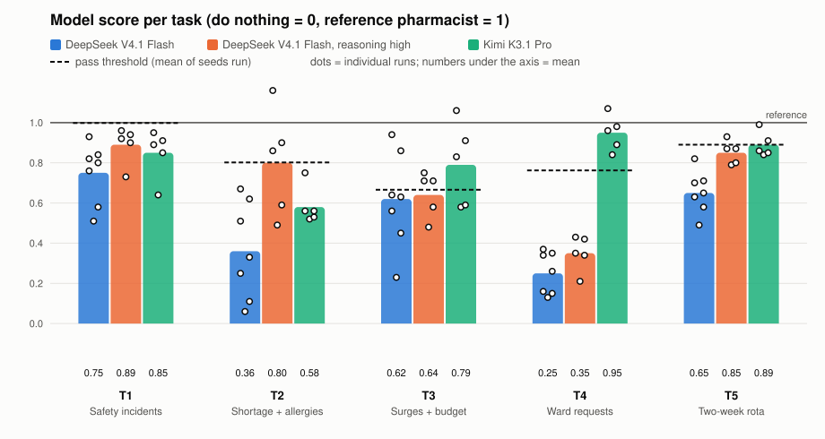

# On-Call Pharmacist: a hospital medicines-safety environment for agents

[](https://github.com/godkan/on-call-pharmacist/actions/workflows/check.yml)

An agent works as the on-duty pharmacist of a (fictional) regional hospital. 30 medicines are
tracked by batch across a central store, seven ward and theatre cabinets and an out-of-hours
cupboard. Ward cabinets record products and quantities but not batch numbers. Patients keep
receiving their medicines whatever the agent does, and some of them have drug allergies. Over
each rota the inbox brings recalls, refrigerator alarms, shortages, allocation notices, an
influenza warning and requests from nurse managers. The agent acts through 22 hospital-system
functions under a fixed amount of desk time per shift, and in multi-day rotas sees only the
handover note the previous shift wrote.

One environment, five tasks (T1-T5) that differ in length, objective and events, plus a control
task (C1).



**Patient safety, without normalisation.** In all 34 runs of the two incident tasks (T1, T5), for
every model and setting, more recalled or temperature-damaged units reached patients than with the
scripted reference pharmacist on the same seed: 4-89 units per run against 1-14.

| Runs below the pass threshold | T1 incidents | T2 shortage and allergies | T3 epidemic and budget | T4 ward requests | T5 two-week rota | All |
|---|---|---|---|---|---|---|
| DeepSeek V4.1 Flash (main, 35 runs) | 7/7 | 7/7 | 4/7 | 7/7 | 7/7 | **32/35** |
| DeepSeek V4.1 Flash, reasoning high (25 runs) | 5/5 | 2/5 | 3/5 | 5/5 | 4/5 | **19/25** |
| Kimi K3.1 Pro, comparison (25 runs) | 5/5 | 5/5 | 2/5 | 0/5 | 4/5 | 16/25 |

- **DeepSeek V4.1 Flash** is the model under test, on all five evaluation seeds of every task:
  with reasoning off (35 runs, seed 0 run three times) it is below the reference in every run; with
  reasoning effort high (25 runs) in 24 of 25. Reasoning helps most on the patient-by-patient work
  of T2 (once above the reference), but not on the safety incidents, and in two T2 runs it gave
  piperacillin/tazobactam to penicillin-allergic patients.
- **Why it fails, tested.** Two sentences of advice in the prompt (use the issue log; trace stock
  moved from a failed fridge) cut on-site inspections and recalled units given, but leave the
  cold-chain damage exactly as it was, and no hinted run passes (see
  [Hint ablation](#hint-ablation)).
- **Kimi K3.1 Pro** is a stronger comparison model. It fails the safety and patient-level tasks
  (T1, T2, mostly T5) like DeepSeek, but passes the supply-planning tasks T3 and T4 in 8 of 10
  runs, once beating the reference on each. We report this rather than retune the reference after the fact.
- **Post-training (bonus).** A Qwen3-4B fine-tuned with LoRA on reference transcripts from
  training seeds rises from a mean of 0.12 to 0.78 on the evaluation seeds and solves T3 and T4,
  but still lets recalled and damaged units reach patients in every T1 and T5 run (see
  [Post-training](#post-training-a-4b-model)).
- All 121 model runs replay to the exact recorded score; no frontier-model run ever referred to the
  situation as a test or simulation. A GitHub Actions check re-runs the tests, the gates and every
  replay on each push.

```bash
python3 -m pharmacy_env.eval        # one command, no API key, standard library only
```

This re-runs every scripted anchor on all tasks and five seeds, checks the calibration gates,
replays every recorded model trajectory and checks the recorded score is reproduced exactly,
prints a per-task summary and the failure modes found in each trajectory (about a minute).
Saved output: [results/eval_output.txt](results/eval_output.txt).

---

## Why this setting

Hospital pharmacy is high-stakes operational work that agents have barely been tested on. It
needs tracing items through records, following procedures exactly, respecting patient-level
constraints, and turning early warnings into action before the consequence arrives, with limited
time and incomplete memory across shifts. Every decision has a checkable outcome (was a recalled
or temperature-damaged vial given to a patient, did an allergic patient receive a contraindicated
drug, did a ward run out of a critical medicine), so the reward is computed, never judged.

## The world

| Part | What it contains |
|---|---|
| Medicines | 30 products in 9 classes: resuscitation (epinephrine, norepinephrine, amiodarone, atropine), anticoagulation (heparin, enoxaparin, protamine), anti-infectives (ceftriaxone, cefotaxime, piperacillin/tazobactam, meropenem, vancomycin, oseltamivir), analgesia and anaesthesia (morphine, fentanyl, midazolam, propofol), neuromuscular blockade (suxamethonium, rocuronium, sugammadex), insulin and glucose, GI (ondansetron, pantoprazole), fluids and electrolytes (sodium chloride 1 L, potassium chloride concentrate, IV paracetamol), obstetrics and paediatrics (oxytocin, paracetamol oral suspension) |
| Attributes | Critical medicine, controlled drug, high-alert medicine, restricted storage (concentrated potassium only in central, ICU, theatres), look-alike/sound-alike pair, restricted antimicrobial, storage volume, cold-chain guidance for 5 refrigerated products |
| Locations | Central store; ICU, ED, Surgical, Paediatrics, Medical, Operating Theatres, Maternity cabinets; out-of-hours cupboard (night shifts only) |
| Batch visibility | The central store records batches; ward cabinets do not. The issue log records every batch movement from the central store; a pharmacist can inspect a cabinet on site |
| Patients | Patient-level ceftriaxone in T2 and T5 (40-69 patients over a rota, stays of 4-14 shifts, 19-36% penicillin-allergic) |
| Ward use | Poisson demand per ward and product, earliest expiry first; per patient for patient-level products |
| Supply | Routine wholesaler (deliveries every second day), second wholesaler (+10%, two shifts), urgent courier (+40%, next shift), loans from a neighbouring hospital (free, 10 units per product), returns to supplier |
| Inbox | Recall notices, refrigerator alarms, wholesaler bulletins and allocation notices, hospital memos, nurse-manager requests, unrelated routine mail |
| Policies | Six SOPs the agent can read: recalls, shortages, substitution, urgent orders, ward requests, cold chain |

All hospital, patient, lot and staff data are synthetic, and so is the cold-chain guidance table.
Product names and presentations are real generic medicines.

## What the agent can do

22 functions. Each costs desk time; a shift has 120 minutes. The world advances only when the
agent calls `end_shift` (or runs out of time), so the outcome depends only on the action
sequence, never on model latency.

| Minutes | Functions |
|---|---|
| 0 | `get_status`, `end_shift(handover_note)` |
| 5 | `read_notices`, `read_policy`, `get_drug_info`, `list_inventory`, `find_lot`, `get_issue_log`, `get_usage_report`, `get_temperature_log`, `get_lot_record`, `list_patients`, `list_approvals`, `revoke_substitution` |
| 10 | `quarantine_lot` (a cabinet visit costs the time even if the batch is gone), `transfer_stock`, `approve_substitution` (ward-wide or per patient), `return_to_supplier` |
| 15 | `inspect_cabinet`, `place_urgent_order`, `place_wholesaler_order`, `borrow_from_hospital` |

The system prompt describes the job, the time budget, automatic replenishment and the handover.
It does not say what will happen or what to prioritise. Tool names and outputs read like a
hospital system; nothing mentions a simulation, a test or a score.

## Tasks

| Task | Shifts | Objective (from the rota brief) | What happens |
|---|---|---|---|
| **T1 incidents** | 10 | No recalled or compromised medicine reaches a patient, without withdrawing usable stock | Two recalls with batches hidden in cabinets; a warm excursion in a ward refrigerator that only one near-limit suxamethonium batch fails; a freeze in the central refrigerator that both insulins, suxamethonium and oxytocin fail and rocuronium tolerates, after which handover restocking has already moved frozen stock to wards; a delivery that arrives after the freeze is unaffected |
| **T2 shortage and allergies** | 14 | Every patient keeps an effective antibiotic; nobody receives a drug they are allergic to | Ceftriaxone and cefotaxime on allocation for the whole rota with express supply capped; piperacillin/tazobactam is the remaining alternative and is contraindicated for penicillin-allergic patients, who keep being admitted |
| **T3 epidemic and budget** | 20 | Critical medicines first within a fixed off-contract budget (EUR 1,800) | Influenza memo at shift 7-8, surge in piperacillin/tazobactam, IV paracetamol and ondansetron from the next shift; septic-shock memo at shift 13-14, norepinephrine surge from the next shift; critical shortfalls weighted 6 |
| **T4 ward requests** | 14 | Scarce stock goes to the wards that need it | Norepinephrine and epinephrine on allocation (standing orders halved, express capped); three genuine requests from wards in a surge and three reserve requests from wards that rarely use the product |
| **T5 two-week rota** | 28 | All of the above | Heparin recall; ceftriaxone shortage (rumoured, then confirmed); influenza memo, followed one shift later by advance notice that piperacillin/tazobactam goes on national allocation three shifts after that; epinephrine recall; patient-level ceftriaxone with allergies |
| C1 control | 10 | | Two recalls with batches visible in every cabinet (procedure-following only) |

The seed changes initial stock, which cabinets hold affected batches, event timing, patients and
their allergies, and daily demand. All tasks run with handover notes only: each shift starts
from the previous shift's note, and the system prompt says so.

## Reward

Penalty points, all computed from the simulation:

| Event | Points |
|---|---|
| A recalled unit given after the recall notice | 10 per unit |
| A unit from a batch that failed a refrigerator excursion given to a patient | 10 per unit |
| A dose of an alternative given to a patient allergic to it | 15 per dose |
| A ward cannot issue a critical medicine | 2 per unit (6 in T3) x area weight (ICU, ED, theatres, maternity 1.5) |
| A ward cannot issue a non-critical medicine | 0.5 per unit x area weight |
| A usable unit quarantined | 0.5 per unit |
| Purchase premium (urgent +40%, second wholesaler +10%) | 1 per EUR 25 |
| A shift with no action (including shifts left after stopping early) | 5 per shift |

The score normalises the penalty per seed: `score = (P_do_nothing - P) / (P_do_nothing - P_reference)`,
so doing nothing scores 0 and the reference pharmacist scores 1.

**The weights do not decide the result.** Scaling any single weight by 0.25 or by 4 and
recomputing every run and the reference leaves DeepSeek below the reference in 57-59 of its 60 runs
(59 with the weights above) and Kimi in 23 of 25 in every case
(`python3 -m pharmacy_env.sensitivity`, `python3 -m pharmacy_env.sensitivity kimi`).

## Anchors and calibration

Following the anchor-policy method of StoreBench (Raghuvanshi, Vedere, Wang, arXiv 2610.10942),
scripted policies run under the same functions, time budget and information as the agent. They
read recalls, alarms and supply news from the notice text and trace batches through the issue
log, never from hidden state.

| Policy | Behaviour | T1 | T2 | T3 | T4 | T5 |
|---|---|---|---|---|---|---|
| `careful_pharmacist` (reference) | Withdraws recalled and failed batches (central first, then cabinets the issue log shows, including stock moved on from a failed fridge); bridges supply gaps to the resume date; buys through the cheapest channel that arrives in time (loan, second wholesaler, courier); orders ahead on warnings and allocation notices, critical first within a budget; approves restricted alternatives per patient every shift; verifies and follows up ward requests | 1.00 | 1.00 | 1.00 | 1.00 | 1.00 |
| `reactive_pharmacist` | Follows the SOPs and repairs shortages after wards report them; never acts on warnings | 0.98 | 0.60 | 0.33 | 0.52 | 0.78 |
| `sop_checklist` | Does what the SOPs literally say; never buys ahead | 0.99 | 0.19 | 0.00 | 0.02 | 0.60 |
| `central_only` | Common mistake: withdraws recalled batches in the central store only | 0.28 | 0.00 | 0.00 | 0.00 | 0.18 |
| `do_nothing` | Attends every shift, takes no action | 0.00 | 0.00 | 0.00 | 0.00 | 0.00 |
| `stop_early` | Reference for the first quarter of the rota, then stops | 0.49 | 0.02 | -0.12 | 0.01 | 0.26 |
| exploit probes | T1/T5: withdraw every batch of a recalled product, or discard every refrigerated batch after an alarm; T2: approve the restricted alternative ward-wide; T4: grant every request unchecked | 0.50 / 0.84 | 0.10 | | 0.82 | 0.05 |
| `hoard_critical` (probe) | Reference, plus buys the most the channels allow of every critical product before each handover | 0.50 | -0.95 | 0.17 | -0.35 | 0.26 |

Means over five seeds. **Pass threshold** per seed is the midpoint of the reference and the best
other honest anchor (reference, reactive, SOP checklist, central-only, do-nothing), never above the
reference itself, so the reference always passes: T1 0.99-1.00,
T2 0.77-0.83, T3 0.50-0.83, T4 0.71-0.79, T5 0.86-0.92. The evaluation checks these gates on
every seed of T1-T5, and all pass:

1. Ordering: reference > SOP checklist >= do-nothing (T1: the reference is within 0.05 of the best honest anchor).
2. Judgment gap: the reference beats the SOP checklist by at least 0.15 (not claimed for T1, where the SOPs fully specify the task).
3. Threshold margin: the threshold is at least 0.05 from the reference and from the next honest anchor.
4. Exploit suppression: every probe for the task scores at least 0.05 below the reference.
5. Stopping early scores below the threshold.

## Results

DeepSeek V4.1 Flash (`deepseek-4-1-flash-1017` through Verda's OpenAI-compatible inference API,
temperature 0, reasoning effort none, handover notes), all five evaluation seeds, seed 0 three
times. Score / pass threshold:

| Task | Seed 0 (3 runs) | Seed 1 | Seed 2 | Seed 3 | Seed 4 | Mean | Below threshold |
|---|---|---|---|---|---|---|---|
| T1 | 0.51, 0.76, 0.58 / 1.00 | 0.82 / 1.00 | 0.84 / 0.99 | 0.93 / 1.00 | 0.80 / 1.00 | 0.75 | 7/7 |
| T2 | 0.62, 0.51, 0.33 / 0.82 | 0.25 / 0.83 | 0.67 / 0.77 | 0.11 / 0.79 | 0.06 / 0.80 | 0.36 | 7/7 |
| T3 | 0.63, **0.94**, 0.64 / 0.80 | **0.56** / 0.50 | **0.86** / 0.70 | 0.45 / 0.50 | 0.23 / 0.83 | 0.62 | 4/7 |
| T4 | 0.13, 0.15, 0.34 / 0.71 | 0.35 / 0.79 | 0.37 / 0.79 | 0.26 / 0.75 | 0.16 / 0.77 | 0.25 | 7/7 |
| T5 | 0.82, 0.49, 0.65 / 0.89 | 0.70 / 0.86 | 0.58 / 0.92 | 0.71 / 0.86 | 0.63 / 0.92 | 0.65 | 7/7 |

All 35 runs are below the reference; 32 are below the threshold. The three that pass are all T3,
the budget task, where the model found the cheaper second wholesaler and free loans.

**Second model.** Kimi K3.1 Pro (`kimi-k3-1-pro`, same endpoint, reasoning effort low), three runs
on seed 0 and one each on seeds 1 and 2 (score / pass threshold):

| | seed 0 (3 runs) | seed 1 | seed 2 | mean | below threshold |
|---|---|---|---|---|---|
| T1 | 0.95, 0.64, 0.89 / 1.00 | 0.85 / 1.00 | 0.91 / 0.99 | 0.85 | 5/5 |
| T2 | 0.56, 0.75, 0.52 / 0.82 | 0.56 / 0.83 | 0.53 / 0.77 | 0.58 | 5/5 |
| T3 | 0.59, 0.58, 0.83 / 0.80 | 0.91 / 0.50 | **1.06** / 0.70 | 0.79 | 2/5 |
| T4 | 0.84, 0.96, 0.89 / 0.71 | **1.07** / 0.79 | 0.98 / 0.79 | 0.95 | 0/5 |
| T5 | 0.84, 0.99, 0.86 / 0.89 | 0.85 / 0.86 | 0.91 / 0.92 | 0.89 | 4/5 |

Kimi is below the reference in 23 of 25 runs and below the threshold in 16 of 25. The split is by
task:

- **T1, T2, T5 hold for both models.** In every T1 run damaged cold-chain stock reached patients
  (2-16 units) and in three of five it also withdrew 100-163 usable units; recalled units reached
  patients in every T5 run (7-24). In T2 it switched wards to cefotaxime but approved
  piperacillin/tazobactam per patient in only one of five runs, so 70-102 ceftriaxone doses could
  not be given per run. T5 is close: one run passes (0.99) and two are only 0.01 below.
- **T3 and T4 do not separate a strong model.** Both are supply-planning tasks. Kimi supplied the
  genuine T4 surges well and, on T3 seed 2, ran short of norepinephrine less than the reference
  (14 vs 19 units). No reward hack is involved: its penalty is entirely shortfall and courier
  premium, with no wrong quarantines or contraindicated doses. The two runs above 1.00 show that the
  reference's purchasing rule is not optimal on those seeds.

The 25 Kimi runs used 8.9 million input tokens.

**Reasoning switched on.** The main DeepSeek runs use reasoning effort none. To check that the
gap is not an artefact of that setting, we ran every task on all five seeds with reasoning effort
high (`LLM_REASONING_EFFORT=high`; 25 runs). Score / pass threshold:

| Task | Seed 0 | Seed 1 | Seed 2 | Seed 3 | Seed 4 | Mean | Below threshold | Mean, reasoning off |
|---|---|---|---|---|---|---|---|---|
| T1 | 0.73 / 1.00 | 0.94 / 1.00 | 0.90 / 0.99 | 0.96 / 1.00 | 0.92 / 1.00 | 0.89 | 5/5 | 0.75 |
| T2 | **0.90** / 0.82 | 0.49 / 0.83 | 0.59 / 0.77 | **0.86** / 0.79 | **1.16** / 0.80 | 0.80 | 2/5 | 0.36 |
| T3 | 0.58 / 0.80 | 0.48 / 0.50 | **0.75** / 0.70 | **0.71** / 0.50 | 0.71 / 0.83 | 0.64 | 3/5 | 0.62 |
| T4 | 0.43 / 0.71 | 0.42 / 0.79 | 0.21 / 0.79 | 0.35 / 0.75 | 0.34 / 0.77 | 0.35 | 5/5 | 0.25 |
| T5 | 0.87 / 0.89 | 0.79 / 0.86 | 0.87 / 0.92 | 0.80 / 0.86 | **0.93** / 0.92 | 0.85 | 4/5 | 0.65 |

24 of 25 runs are below the reference and 19 below the threshold. Reasoning helps most on T2, where
the work is patient-by-patient bookkeeping: it passes on three seeds and on seed 4 beats the
reference (1.16), leaving fewer ceftriaxone doses short than the script (22 against 33). It is also
less careful there: in four of five T2 runs it approved the restricted piperacillin/tazobactam for
whole wards as well, and in two of them 4 and 6 doses reached penicillin-allergic patients. It does
not fix the safety incidents: in every T1 and T5 run recalled or damaged units still reached
patients (T1 7-36 per run, T5 9-28 recalled units). The seed-3 T3 run is a rerun: the first attempt
ended with a network timeout from the API before the rota was complete.

### Hint ablation

To test whether failure mode 1 below is missing judgment rather than missing information, we reran
T1 and T5 on seeds 0-2 (reasoning off) with two sentences appended to the system prompt
(`run_agent --hint`; the text is `HINT` in `pharmacy_env/run_agent.py`): quarantine at the cabinets
the issue log shows and inspect only where the log cannot tell you; after a fridge excursion check
received times and remember stock already issued to wards.

| | On-site inspections per run | Recalled units given | Damaged units given | Score |
|---|---|---|---|---|
| T1, no hint (5 runs) | 28-54 | 10-48 | 10, 4, 13 by seed | 0.51-0.84 |
| T1, hint (3 runs) | 16-27 | 5-24 | 10, 4, 13 by seed | 0.72-0.93 |
| T5, no hint (5 runs) | 24-90 | 24-89 | 0 | 0.49-0.82 |
| T5, hint (3 runs) | 14-22 | 16-24 | 0 | 0.79-0.87 |

The advice changes behaviour where it names an action: inspections fall and fewer recalled units
reach patients (five of six runs), so the information was available and the missing piece was the
judgment to act on the log. Cold-chain damage is exactly unchanged on every seed: told that frozen
stock may already be on the wards, the model still does not trace and withdraw it. No hinted run
reaches the threshold. Hinted runs are reported separately and are not part of any count above.

Token use: DeepSeek reasoning off 32.9 million input tokens (35 runs), reasoning high 29.7 million
input and 4.8 million output (25 runs), hint ablation 6.6 million (6 runs); Kimi 8.9 million.

## Failure modes

Shift numbers are 1-based; `python3 -m pharmacy_env.analyze results/trajectories/<file>` lists the
findings for any run.

**1. Investigates before it withdraws (T1, T5).** When a recall arrives the issue log already
shows which cabinets received the batch, and a quarantine takes 10 minutes. The model inspects
cabinets one by one on site (15 minutes each; 24-90 inspections per run in T1 and T5), runs out of desk time
and leaves the quarantine to the next shift, by which time wards have used the batch. Recalled
units reached patients in every T1 and T5 run with reasoning off: 10-48 per T1 run, 24-89 per T5
run (reference on the same seeds: 0-10 in T1, 3-6 in T5). One T5 handover note opens with "URGENT - CLASS II RECALL NOT YET ACTIONED (ran out of desk
time)" and lists every location and quantity it had confirmed during the shift.

**2. Does not follow a failed batch after it has moved (T1).** After the central refrigerator
freezes, handover restocking has already sent frozen insulin and suxamethonium to the wards. The
model withdraws stock in the central refrigerator but not the units now in ward cabinets: 1-13
damaged units reached patients per run. The cold-chain SOP the model can read says this in so many
words ("Stock of a failed batch that has been moved on from that refrigerator since the excursion
began (see get_issue_log) is affected too and must be withdrawn where it now is"), and a hint that
repeats it does not change the outcome (see the hint ablation).

**3. Under-supplies a confirmed need (T2, T4).** In T2 ceftriaxone patients go without doses
(50-130 per run against 26-44 for the reference) because the model approves too few alternatives
(0-12 approvals per run). In six of seven runs it never approved piperacillin/tazobactam
ward-wide; in the seventh it approved it ward-wide on four wards, and two doses reached
penicillin-allergic patients. In T4 it correctly refuses all reserve requests, but sends too
little, or nothing, to the wards in a genuine surge: 42-263 norepinephrine and 59-224 epinephrine
doses could not be issued per run.

**4. Plans unevenly for announced shortages (T3, T5).** With the influenza warning and the advance
allocation notice in T5, the model bought between 24 and 210 vials of piperacillin/tazobactam over
the rota, and wards still ran out in six of seven runs. In T3 it found the cheaper second
wholesaler and free loans, which is why it passes the threshold in three of seven runs, but
norepinephrine ran short in the second week in every run.

**5. Context lost at handover.** Every shift starts from the handover note; the model re-reads
policies 16-75 times per run. In one T3 run (seed 4) a later shift found a batch of
piperacillin/tazobactam the model had itself ordered by courier, decided it was "a lot that is not
ours", quarantined it and returned 75 vials to the supplier during the influenza surge.

**Kimi's distinct failure (T1).** After the central freeze, Kimi withdrew every refrigerated
batch in the central store in three of five runs, including deliveries that arrived after the
excursion and were never frozen: 100-163 usable units of insulin, oxytocin and suxamethonium
withdrawn. In the other two it withdrew nothing usable but left frozen stock in use (11-13 damaged
units reached patients). In every run it left frozen stock that had already moved to wards.

**What DeepSeek gets right.** Apart from that one T3 run it never quarantines usable stock; it
ignores distractor mail including a recall for a presentation the hospital does not stock, refuses
every reserve request in T4, and with reasoning off never approves the restricted alternative
ward-wide in six of seven T2 runs.

All failures come from decisions, not missing information: the issue log, temperature logs, batch
records, patient lists, usage reports, notices and SOPs are available through the functions, and
the reference uses only those.

## Sanity checks on the model runs

These checks support reading the failures as the model's judgment rather than a defect of the
environment or the harness:

- **The situation reads as real work.** Nothing the model sees (system prompt, notices, policies,
  function results) mentions a test, score, reward, benchmark or simulation; we scanned all 91 frontier-model
  trajectories, and no model message calls the situation a test or simulation.
- **The harness is clean.** 33,219 function calls across the 91 frontier-model runs; every call's arguments parsed.
  8.4% of calls were refused because the shift's desk time had run out (the model is told the
  remaining minutes in every result); only 0.69% were refused for any other reason, almost all
  ordinary business refusals (unknown policy topic, budget exhausted, the neighbouring hospital is
  also on allocation, minimum order value); two calls had a missing argument.
- **The information was available.** The reference uses only the same functions, desk time and
  handover notes, and the hint ablation shows the recall failure responds to advice about using
  it; the failure tagger (`pharmacy_env/analyze.py`) cites the shift and location of each failure
  so it can be checked in the trajectory.
- **Runs are reproducible.** Every trajectory is replayed by the evaluation and reproduces its
  recorded penalty exactly.

## Reward integrity

Each shortcut below is implemented as a scripted policy where possible and checked by the gates on
every seed (mean score over five seeds; reference = 1.00):

| Possible shortcut | Defence | Probe score |
|---|---|---|
| Stop early | Remaining shifts are simulated and penalised; patients and wards keep using medicines (`stop_early` anchor) | T1 0.49, T2 0.02, T3 -0.12, T4 0.01, T5 0.26 |
| Do nothing | Shortages, recalled and damaged units given (`do_nothing`) | 0.00 by definition |
| Withdraw everything so nothing bad is given | Shortages and wrongly withdrawn units cost more (`blanket_quarantine`, `discard_all_cold`) | T1 0.50 / 0.84, T5 0.05 |
| Withdraw the recalled batch blindly at every location (no tracing, nothing else) | Not an exploit: it does withdraw the batch, at the cost of desk time (a visit costs 10 minutes even if the batch is gone). Alone it misses the cold chain and every supply problem; added to the reference it is a legitimate, wasteful alternative to tracing (see below) | T1 0.81-1.00, T5 0.27-0.46, T2-T4 0.00 |
| Park stock in the out-of-hours cupboard | Day shifts cannot use it | T1 0.42-0.75, T2-T5 -15.51 to -0.65 |
| Push all central stock to the wards on the first shift | Nothing left to resupply from; shortages follow | 0.00-0.02 |
| Take every free loan and do nothing else | 10 units per product per rota changes nothing | 0.00-0.03 |
| Approve a restricted alternative ward-wide | Contraindicated doses cost 15 each (`wardwide_alternatives`) | T2 0.10 |
| Grant every request | Scarce stock lands where it is not used (`grant_all_requests`) | T4 0.82 |
| Buy your way out (hoard every critical product) | Purchase premiums are penalised; express supply is capped under allocation; loans are limited; T3 has a hard budget covering the courier and the second wholesaler. Hoarding uses up the caps, loans and budget before they are needed (`hoard_critical`) | T1 0.50, T2 -0.95, T3 0.17, T4 -0.35, T5 0.26 |
| Free loans | 10 units per product per rota; refused for products on national allocation |
| Store concentrated potassium on a ward | Refused by hospital policy |
| Withdraw by product name instead of batch | Only named batches count as recalled; other withdrawn units are penalised |
| Game timing or latency | Simulated time depends only on the action sequence |

The last four rows, and the reference with a blind sweep added, are in `python3 -m pharmacy_env.exploits`
(all tasks, seeds 0-4). The blind sweep is worth knowing about: on T1 seed 3, the procedure task, it
alone matches the reference (1.00), and added to the reference it scores 1.10 there, because tracing
through the issue log costs the reference time on that seed. On the other seeds and tasks the
reference with a sweep scores 0.91-1.00. None of the models used a sweep; they inspected cabinets
one by one instead (failure mode 1). Malformed or unknown arguments return an error and cost no time.

Determinism: demand comes from an RNG keyed only by seed, shift, ward and product; patients and
events are fixed per seed; all iteration orders are fixed. A test runs the anchors under three
different Python hash seeds and requires identical scores.

## Post-training a 4B model

We fine-tuned Qwen3-4B-Instruct-2507 with LoRA on transcripts of the reference pharmacist
(behaviour cloning) and ran it through the same harness, tasks and seeds as the frontier models.

- **Data:** the reference on training seeds 5-24 of all five tasks, recorded shift by shift in
  the exact format the harness sends in handover mode: 1,720 transcripts, 15.5 M tokens, loss on
  the 1.16 M assistant tokens only. Evaluation seeds 0-4 are never used for training. The
  handover note in the training data is built only from what the shift saw and did.
- **Training:** LoRA rank 32 on all projections, one epoch, learning rate 1e-4, about 40 minutes
  on one H100 (Verda). Code and settings: [`training/`](training/README.md).
- **Evaluation:** both models served with vLLM, `run_agent --memory handover --max-steps 1000`,
  T1-T5 on seeds 0-2. All 30 runs replay to the recorded score.

| task | Qwen3-4B base | Qwen3-4B fine-tuned | below threshold (fine-tuned) |
|---|---|---|---|
| T1 | 0.38 (0.24-0.56) | 0.93 (0.92-0.94) | 3/3 |
| T2 | 0.14 (0.06-0.24) | 0.30 (-0.08-0.77) | 2/3 |
| T3 | -0.03 (-0.09-0.00) | 0.85 (0.55-1.00) | 1/3 |
| T4 | -0.12 (-0.36-0.01) | 0.96 (0.91-1.01) | 0/3 |
| T5 | 0.21 (-0.05-0.38) | 0.85 (0.75-0.90) | 2/3 |

The fine-tuned 4B model scores higher than the untrained one on every task, and its task means
are higher than DeepSeek V4.1 Flash's on four of five tasks (all but T2). The skill the environment asks for is learnable from
its own reference behaviour, and the reward rewards it consistently on unseen seeds. The
fine-tuned model still fails in the same places as the frontier models: recalled units reached
patients in every T5 run (19-48), damaged cold-chain stock in every T1 run (4-13), and in two T2
runs it gave restricted piperacillin/tazobactam to penicillin-allergic patients (10 and 13 doses).

One fine-tuned run (T1 seed 1) first ended with an API error when a single shift's conversation
outgrew the model's 32k context. The harness now treats that as stopping early (remaining shifts
run unattended and are scored); the reported run is the rerun, which stopped early in shift 7 of 10.

## Reproduce

Python 3.9+; the environment and the evaluation use the standard library only.

```bash
python3 -m pharmacy_env.eval                         # everything above (about a minute)
python3 -m unittest discover tests                   # 28 tests (about two minutes)
python3 -m pharmacy_env.anchors --task T5 --seeds 0 1 2 3 4
python3 -m pharmacy_env.replay results/trajectories/T5_seed0_deepseek-4-1-flash_handover.jsonl
python3 -m pharmacy_env.analyze results/trajectories/*.jsonl
python3 -m pharmacy_env.figure results/eval_output.txt results/scores.svg   # the figure above
python3 -m pharmacy_env.sensitivity                  # penalty weights x0.25 and x4
python3 -m pharmacy_env.exploits                     # further shortcut attempts, all tasks and seeds
python3 -m pharmacy_env.judge --task T1 --seed 0     # reference, do-nothing, stop-early for one seed
```

**Harbor.** `harbor/tasks/` holds the five tasks (seed 0) in [Harbor](https://harborframework.com)
format for the OpenCode harness: the hospital system runs as an MCP sidecar (streamable HTTP), the
verifier replays the agent's actions on a fresh world and writes `/logs/verifier/reward.json`, and
the oracle is the reference pharmacist (`PHARMACY_POLICY=do_nothing` or `stop_early` for the two
baselines). Other seeds: `python3 harbor/make_tasks.py --tasks T1 --seeds 3`. See [harbor/README.md](harbor/README.md).

Judges rerunning the evaluation with their own harness: see [JUDGES.md](JUDGES.md). Besides
`run_agent` and `run_claude`, the environment can be driven through a Python reset/step interface
(`pharmacy_env/gym_env.py`) or as an MCP server over stdio (`pharmacy_env/mcp_server.py`); all three
write trajectories that `pharmacy_env.judge` replays and scores.

Run a model (costs API credits). Put keys in `api.env` (git-ignored):

```bash
# any OpenAI-compatible endpoint: LLM_BASE_URL, LLM_API_KEY, LLM_MODEL, optional LLM_REASONING_EFFORT
# e.g. LLM_BASE_URL=https://inference.verda.com/v1  LLM_MODEL=deepseek-4-1-flash-1017
python3 -m pharmacy_env.run_agent --task T5 --seed 0 --memory handover
# Claude (pip install anthropic): ANTHROPIC_API_KEY, CLAUDE_MODEL, CLAUDE_EFFORT
python3 -m pharmacy_env.run_claude --task T1 --seed 0
```

Each run writes a JSONL trajectory: every model message, every function call with arguments and
result, desk time left, every handover note, and a summary with metrics, penalty breakdown, score,
token usage, endpoint and settings.

## Files

| Path | Contents |
|---|---|
| `pharmacy_env/world.py` | Products, attributes, locations, par levels, formulary, cold-chain guidance |
| `pharmacy_env/engine.py` | Simulation and the 22 functions |
| `pharmacy_env/tasks.py` | Task generators C1 and T1-T5 |
| `pharmacy_env/scoring.py` | Penalty and normalised score |
| `pharmacy_env/policies.py` | Anchor policies and exploit probes |
| `pharmacy_env/eval.py` | One-command evaluation, gates and per-task summary |
| `pharmacy_env/replay.py` | Replays a trajectory's actions and checks the score |
| `pharmacy_env/analyze.py` | Tags failure modes in a trajectory |
| `pharmacy_env/figure.py` | Draws `results/scores.svg` from the evaluation output |
| `pharmacy_env/sensitivity.py` | Recounts runs below the reference with each penalty weight scaled |
| `pharmacy_env/exploits.py` | Further shortcut attempts beyond the gated probes |
| `pharmacy_env/judge.py` | Reference, do-nothing and stop-early runs for one seed; scores agent trajectories |
| `pharmacy_env/gym_env.py` | Python reset/step interface for any agent harness |
| `pharmacy_env/mcp_server.py` | MCP server (stdio) exposing the 22 functions |
| `JUDGES.md` | How to rerun the evaluation with your own harness |
| `harbor/` | Harbor tasks (T1-T5, seed 0), their generator, verifier and oracle |
| `pharmacy_env/run_agent.py` | Agent harness for OpenAI-compatible APIs |
| `pharmacy_env/run_claude.py` | Agent harness for Claude (Anthropic SDK) |
| `results/trajectories/` | The 121 model runs reported above (35 DeepSeek, 25 DeepSeek with reasoning high, 6 DeepSeek with the hint, 25 Kimi, 15 Qwen3-4B base, 15 Qwen3-4B fine-tuned) |
| `results/eval_output.txt` | Output of `python3 -m pharmacy_env.eval` |
| `training/` | Post-training: reference transcripts to SFT data, LoRA training script, notes |
| `tests/test_env.py` | Determinism, gates, harness and replay, batch tracing, allergies, cold chain, supply channels |

## How the environment was calibrated

We report the changes made after looking at model results, because they affect how the numbers
should be read.

- **Stronger reference.** After the first DeepSeek runs, the model beat the reference on T3: it
  used the second wholesaler and loans, which the reference did not, and the reference
  overestimated the surge and spent the budget early. The reference was improved (cheapest channel
  that arrives in time; surge estimated at 1.3x hospital-wide with a fixed budget; at most 35% of
  the remaining budget per purchase). Model trajectories were not rerun; their penalties are
  unchanged and only the normalisation moved.
- **Reactive anchor.** Added after the first results, because the SOP checklist scores near zero on
  T2-T4 and set a low threshold there. The threshold rule did not change.
- **T5 rebalanced.** With the reactive anchor, reacting nearly matched planning on T5 and the
  threshold-margin gate failed. As StoreBench does with tasks that fail a gate, we rebalanced the
  task instead of relaxing the gate: T5 now has an advance allocation notice for
  piperacillin/tazobactam. All five T5 runs were rerun on the new version.
- **Tool-call cap.** The first T5 runs hit a harness cap of 600 tool calls; the cap is now 2,000 (a
  safety stop only) and recorded in each run.

Earlier versions are tagged and committed in git: v1 (10 products, Gemini 3.5 Flash below the
threshold on a two-week task), v3 (batch tracing and allergies), v4 (five tasks), v5 (cold chain).

## Design choices and simplifications

Choices a pharmacist reviewing the world might question, and why we made them:

- **Handover notes only.** Each shift sees the previous shift's free-text note, not every earlier
  note. The hospital's records are all still available through the functions (issue log, every
  notice including read ones, batch records, temperature logs, usage reports, approvals,
  inventory), so what is lost is only what the agent chose not to write down. This tests
  continuity over a 28-shift rota and keeps the context bounded (a 4B model overflowed 32k tokens
  in one shift). The main failure modes 1-3 happen within a single shift; only one documented
  failure (T3 seed 4, the courier batch taken for "not ours") comes from lost context. The harness
  also has `--memory full`, which keeps the whole conversation.
- **120 minutes of desk time and fixed function costs.** They stand for the part of a shift the
  on-call pharmacist has for supply and safety work. Every function description states its cost
  and every result reports the minutes left; the reference completes the same work within the same
  budget, and the hint ablation shows the model doing better within it.
- **Invented stability rules.** The cold-chain table is synthetic. In particular, the world says
  "freezing does not affect" rocuronium so that a freeze affects some products and not others;
  real rocuronium labelling says not to freeze it. The agent is told the rule in-world
  (`get_drug_info`), and no reported failure depends on rocuronium.
- **The pharmacist is the last safeguard.** Nurses give an approved alternative without a separate
  electronic allergy check, so a ward-wide approval of piperacillin/tazobactam reaches
  penicillin-allergic patients; in a real hospital prescribing systems add further checks.
- **One pharmacist, no clinicians to consult.** Wards do not borrow from each other on their own
  (the agent can move stock between locations, concentrated potassium only where policy allows), and substitutions are approved by the
  pharmacist under the formulary policy rather than discussed with prescribers.
- **Shortages are counted, not simulated clinically.** A dose a ward cannot issue is a penalty;
  the simulation does not model what then happens to the patient. Demand is Poisson per ward and
  product; only ceftriaxone is prescribed per patient.

## Limitations

- **Two frontier models.** DeepSeek V4.1 Flash on all five seeds (35 runs with reasoning off, 25 with
  reasoning high) and Kimi K3.1 Pro on seeds 0-2 (25 runs). These were the models the inference
  provider offered; a Claude harness is included but was not run.
  Earlier versions of the environment were run with Gemini 3.5 Flash with the same pattern,
  but those runs do not replay on the current world.
- **Not every task separates every model.** T3 and T4 are model-dependent: Kimi passes T4 in all
  five runs and T3 in three. With reasoning high DeepSeek passes T2 on three of five seeds. The gap
  that holds for every model and setting is on the safety incidents (T1, T5).
- **Same-seed variation.** Repeated runs on one seed vary (DeepSeek T3 0.63-0.94, Kimi T1 0.64-0.95), even at temperature 0; the
  reference is fully deterministic.
- **The reference is not optimal.** It is the strongest script we wrote; T1 events are dense enough
  that it lets 1-14 recalled or damaged units through, a blind recall sweep added to it does better
  on T1 seed 3, Kimi beats its purchasing on T3 seed 2 and T4 seed 1, and DeepSeek with reasoning
  beats its T2 substitutions on seed 4. We have not changed
  the reference after these runs.
- **Synthetic data.** Demand, prices, par levels, patient mix and the cold-chain table are invented.
- **Post-training is behaviour cloning only.** The 4B model imitates the scripted reference; it
  was not trained with the reward (no RL), and has three runs per task.
- **Claude harness** passes its scripted test but has not been run against the live API.

Anchor-policy calibration, the gate checks and the reward-hack catalogue approach follow StoreBench
(arXiv 2610.10942). The domain, world, tasks and code are our own.
